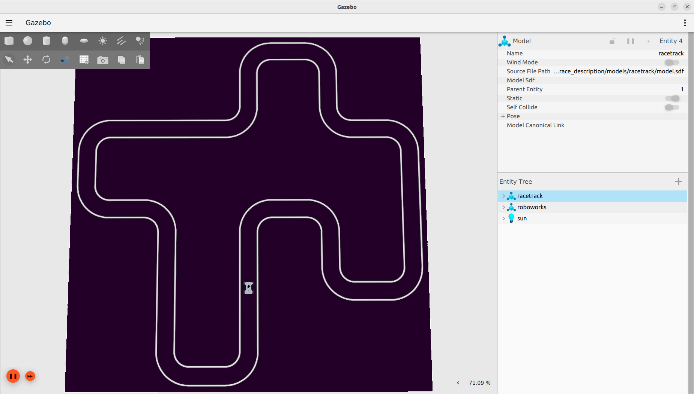
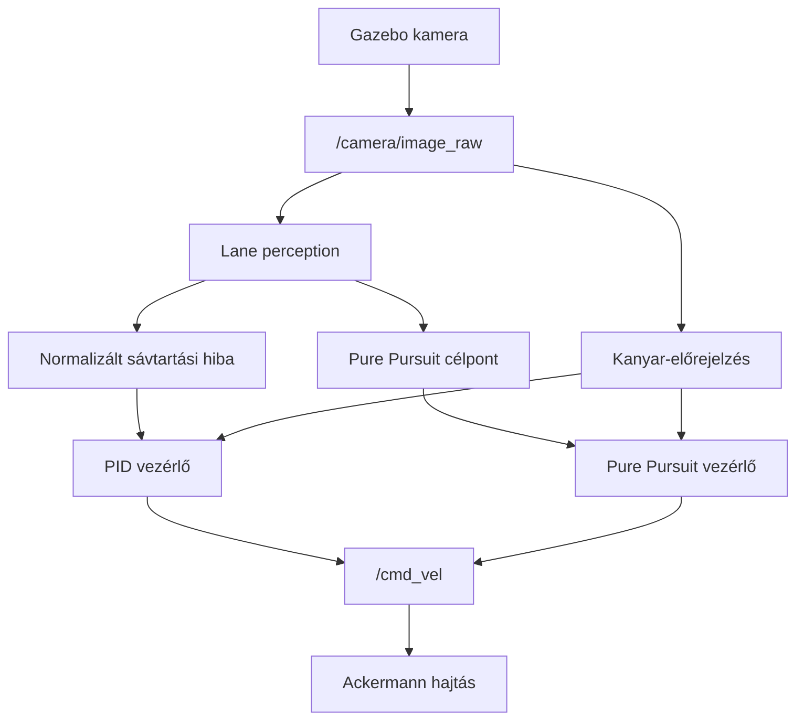
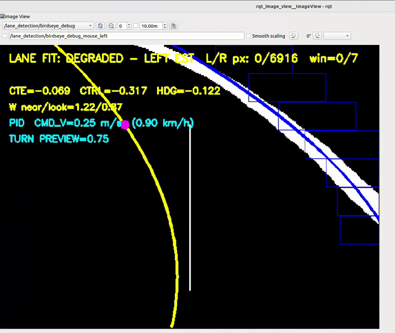
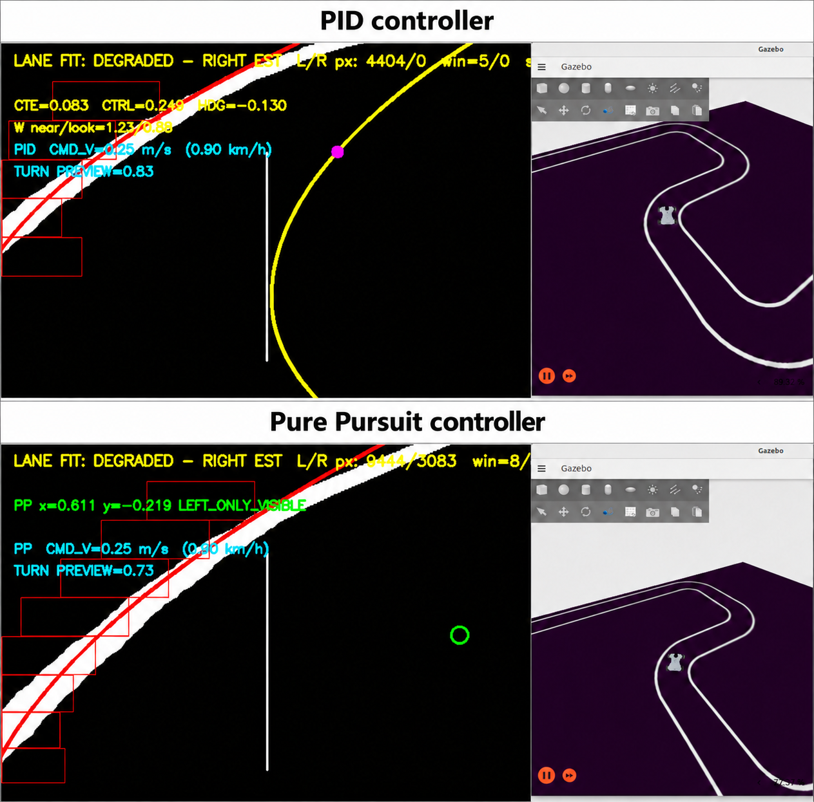
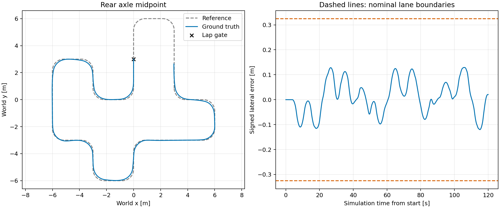

# Wheeltec AutoRace Simulation

[](https://docs.ros.org/en/humble/)
[](https://gazebosim.org/docs/fortress/)
[](https://releases.ubuntu.com/22.04/)

ROS 2 és Gazebo alapú szimuláció Wheeltec / Roboworks robot kameraalapú sávtartásához. A projekt PID és Pure Pursuit vezérlőt, véletlen pályagenerálást, kanyar előtti sebességtervezést és független pályakövetési kiértékelést tartalmaz.



## ROS 2 csomagok

| Csomag | Feladat |
|---|---|
| `wheeltec_autorace_application` | Sávfelismerés, PID és Pure Pursuit vezérlés |
| `wheeltec_autorace_bringup` | Szimuláció, bridge-ek és vezérlők indítása |
| `wheeltec_autorace_description` | Robot- és pályamodellek |
| `wheeltec_autorace_gazebo` | Gazebo világfájlok |
| `wheeltec_autorace_evaluation` | Referencia-export, mérés és eredményábra |

## A rendszer működése



A `lane_perception` fehér vonalakat szegmentál, felülnézeti képet készít, majd sliding window kereséssel és polinomillesztéssel meghatározza a sávhatárokat. A PID normalizált képtérbeli hibát követ, a Pure Pursuit pedig méterben megadott célpontból számít görbületet. A kanyar-előrejelzés mindkét vezérlő sebességét korlátozhatja. Egy futásban csak egy vezérlő publikáljon a `/cmd_vel` topicra.



## Telepítés és build

A parancsok a `~/ros2_ws` workspace-t feltételezik.

```bash
mkdir -p ~/ros2_ws/src
cd ~/ros2_ws/src
git clone https://github.com/kopaj/wheeltec_autorace_sim.git

source /opt/ros/humble/setup.bash
cd ~/ros2_ws
rosdep install --from-paths src --ignore-src -r -y --rosdistro humble
colcon build --symlink-install
source install/setup.bash
```

<details>
<summary>Környezet betöltése minden új terminálban</summary>

```bash
source /opt/ros/humble/setup.bash
source ~/ros2_ws/install/setup.bash
```

</details>

## Szimuláció indítása

PID vezérlővel:

```bash
ros2 launch wheeltec_autorace_bringup simulation.launch.py controller:=pid
```

Pure Pursuit vezérlővel:

```bash
ros2 launch wheeltec_autorace_bringup simulation.launch.py controller:=pure_pursuit
```

### Új véletlen pálya

```bash
ros2 launch wheeltec_autorace_bringup random_simulation.launch.py \
  controller:=pure_pursuit \
  min_track_size:=10.0 max_track_size:=14.0 \
  min_turns:=8 max_turns:=12 variation:=0.65
```

A random launch elkészíti a pályát és a hozzá tartozó mérési referenciát:

- `~/wheeltec_benchmark/track_debug.png`
- `~/wheeltec_benchmark/track_metadata.json`
- `~/wheeltec_benchmark/reference.json`

Azonos pályán végzett összehasonlításhoz csak az első futást indítsd így; utána használd a `simulation.launch.py` fájlt.

## A vezérlő engedélyezése

A robot nyugalomba kerülése után, külön terminálban add ki a kiválasztott vezérlő parancsát.

PID:

```bash
ros2 service call /pid_lane_controller/enable std_srvs/srv/SetBool '{data: true}'
```

Pure Pursuit:

```bash
ros2 service call /pure_pursuit_controller/enable std_srvs/srv/SetBool '{data: true}'
```

Leállításhoz ugyanazt a service-t hívd `'{data: false}'` értékkel.



## Hasznos topicok

| Topic | Tartalom |
|---|---|
| `/camera/image_raw` | Eredeti kamerakép |
| `/lane_detection/birdseye_debug` | Sávfelismerés és vezérlőadatok |
| `/lane_detection/turn_preview_debug` | Kanyar-előrejelzés debug képe |
| `/lane_detection/target` | Pure Pursuit célpont |
| `/control/pid/status` | PID állapot |
| `/control/pure_pursuit/status` | Pure Pursuit állapot |
| `/cmd_vel` | Parancsolt sebesség és szögsebesség |

Példák:

```bash
ros2 topic echo /control/pid/status
ros2 topic echo /control/pure_pursuit/status
ros2 topic hz /camera/image_raw
```

## Pályakövetési mérés

A mérés a Gazebo ground-truth robotpózát hasonlítja a pálya referencia-középvonalához. Futó szimuláció mellett, a vezérlő engedélyezése előtt indítsd el:

```bash
ros2 launch wheeltec_autorace_evaluation evaluate.launch.py \
  reference:=$HOME/wheeltec_benchmark/reference.json \
  label:=pid_trial01 duration:=60.0
```

Ezután élesítsd a mérést, majd engedélyezd a vezérlőt:

```bash
ros2 service call /evaluation/start std_srvs/srv/Trigger '{}'
```

Az eredmények a `~/wheeltec_results/<időpont>_<label>/` mappába kerülnek. Az eredményábra elkészítése:

```bash
ros2 run wheeltec_autorace_evaluation plot_tracking \
  ~/wheeltec_results/IDE_A_MERES_MAPPAJA
```

A kimenet ugyanebben a mappában `tracking.png` néven jelenik meg.



A külső modellek és összetevők forrásai a [THIRD_PARTY.md](THIRD_PARTY.md) fájlban találhatók.
